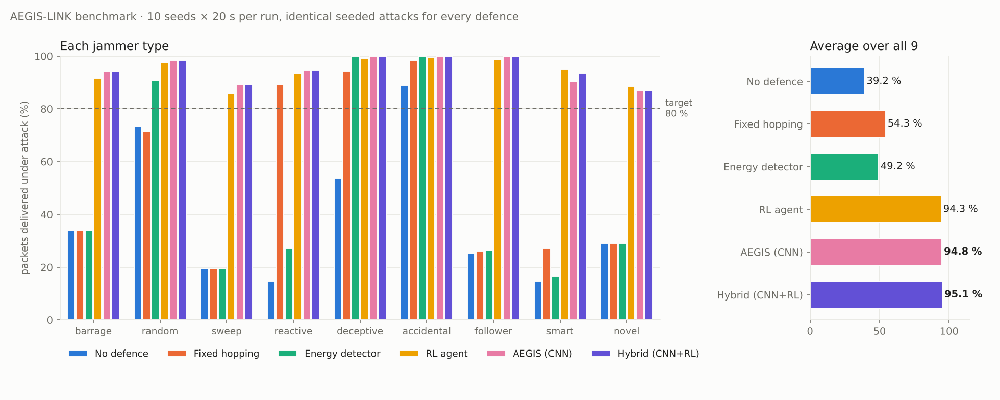

# AEGIS-LINK benchmark results

Seed-replayed benchmark: `python -m sim.benchmark --seeds 10 --duration 20` (2026-11-21 13:05:28).
For every jammer type and seed, all six defences face an **identical run**: same seed (motion, fading,
jammer randomness), same jammer, same position, same start time (t = 2 s), 20 s per run,
10 seeds → 540 runs. Delivery = packets that reached the command post after the jammer started.
The unknown-jammer memory is emptied before every run, so no defence benefits from an earlier run.
All results are from the simulator; nothing here is measured on real radios (see `HARDWARE_TEST_PLAN.md`).

## Packets delivered under attack (mean over 10 seeds; best per row in bold)

| Jammer | No defence | Fixed hopping (FHSS) | Energy detector | RL agent (Q-learning) | AEGIS (CNN + rules) | Hybrid (AEGIS + RL) |
|---|---|---|---|---|---|---|
| barrage | 33.9 % | 33.9 % | 33.9 % | 91.7 % | **93.9 %** | **93.9 %** |
| random | 73.2 % | 71.3 % | 90.7 % | 97.5 % | **98.5 %** | **98.5 %** |
| sweep | 19.4 % | 19.4 % | 19.4 % | 85.7 % | **89.2 %** | **89.2 %** |
| reactive | 14.7 % | 89.1 % | 27.1 % | 93.1 % | 94.5 % | **94.6 %** |
| deceptive | 53.8 % | 94.1 % | **99.9 %** | 99.2 % | **99.9 %** | **99.9 %** |
| accidental | 88.9 % | 98.4 % | **100.0 %** | 99.6 % | **100.0 %** | **100.0 %** |
| follower | 25.1 % | 26.1 % | 26.4 % | 98.6 % | **99.8 %** | **99.8 %** |
| smart | 14.7 % | 27.0 % | 16.7 % | **94.9 %** | 90.3 % | 93.3 % |
| novel | 29.1 % | 29.1 % | 29.1 % | **88.5 %** | 86.8 % | 86.8 % |
| **mean** | **39.2 %** | **54.3 %** | **49.2 %** | **94.3 %** | **94.8 %** | **95.1 %** |

## Headline numbers

| | Fixed hopping (AI OFF) | RL agent | AEGIS (CNN) | **Hybrid (AI ON)** |
|---|---|---|---|---|
| Mean packets delivered | 54.3 % | 94.3 % | 94.8 % | **95.1 %** |
| 95 % CI of the mean (over 10 seeds) | 50.6–58.0 % | 93.7–95.0 % | 94.0–95.6 % | **94.3–95.9 %** |
| SD of the mean over seeds | 5.2 | 0.9 | 1.1 | 1.1 |
| Worst jammer type (mean) | 19.4 % (sweep) | 85.7 % (sweep) | 86.8 % (novel) | **86.8 % (novel)** (target ≥ 80 %) |
| Worst single run | 3.3 % | 75.1 % | 75.8 % | 75.8 % |
| Mean outage per 18 s attack | 9.1 s | 1.1 s | 0.9 s | **0.9 s** |
| Hop latency p50 / p95 / p99 | — | 40 / 160 / 240.5 ms | 20 / 50 / 193.4 ms | 20 / 110 / 206 ms |
| CNN verdicts correct during live runs | — | — (no classifier) | 95.4 % | 95.1 % (target > 90 %) |
| Forged frames accepted | 0 | 0 | 0 | **0** |

The three AI defences overlap within their confidence intervals on the mean: the honest claim is
"all three AI defences are far above the non-AI ones (54 % → 94–95 %), and the hybrid is at least as good as
either alone", not "the hybrid is significantly best".

**Hop latency** is measured from the first jammed slot to the moment the whole network is on a new channel.
Median 20 ms; the p95 of the hybrid (110 ms) misses the 100 ms target. The tail is not slow reactions:
against wideband jammers the AI deliberately tries more power and BPSK first, and only hops later if that
fails, so the clock keeps running. `ROBUSTNESS.md` also reports the *response* latency (first jammed slot →
first countermeasure of any kind in force) broken down by condition.

## AI OFF vs AI ON, with spread (10 seeds each)

| Jammer | AI OFF (fixed hopping) mean ± SD | 95 % CI | worst run | **AI ON (hybrid)** mean ± SD | 95 % CI | worst run |
|---|---|---|---|---|---|---|
| barrage | 33.9 ± 22.7 | 17.7–50.1 | 10.0 | **93.9 ± 6.1** | 89.6–98.3 | 78.1 |
| random | 71.3 ± 2.1 | 69.8–72.8 | 67.6 | **98.5 ± 1.0** | 97.8–99.2 | 97.0 |
| sweep | 19.4 ± 12.9 | 10.2–28.7 | 4.6 | **89.2 ± 6.9** | 84.3–94.2 | 75.8 |
| reactive | 89.1 ± 0.9 | 88.4–89.8 | 88.0 | **94.6 ± 0.7** | 94.1–95.1 | 93.8 |
| deceptive | 94.1 ± 2.1 | 92.5–95.6 | 92.4 | **99.9 ± 0.0** | 99.9–100.0 | 99.9 |
| accidental | 98.4 ± 0.6 | 98.0–98.8 | 97.5 | **100.0 ± 0.1** | 99.9–100.0 | 99.9 |
| follower | 26.1 ± 27.6 | 6.4–45.9 | 3.6 | **99.8 ± 0.1** | 99.7–99.8 | 99.7 |
| smart | 27.0 ± 4.8 | 23.6–30.4 | 21.4 | **93.3 ± 1.6** | 92.1–94.5 | 90.8 |
| novel | 29.1 ± 16.4 | 17.4–40.8 | 3.3 | **86.8 ± 6.1** | 82.4–91.2 | 76.7 |

## The six defences

- **No defence:** stays on one channel.
- **Fixed hopping (FHSS):** a public repeating hop pattern, one channel per 10 ms slot. This is the AI OFF side.
- **Energy detector:** when loss passes 10 %, hop to the quietest channel. No classification.
- **RL agent (Q-learning):** `ai/rl.py`. Learns from scratch in this simulator which of five moves (stay, hop,
  keyed hopping, more power / BPSK, calm down) to make every 100 ms, from packet loss and per-channel energy only.
  256 states × 5 actions, trained on seeds separate from the benchmark (`python -m ai.rl --train`, ~2 min).
- **AEGIS (CNN + rules):** the CNN names the jammer (with Grad-CAM evidence), a behaviour tracker can flag several
  behaviours at once, and a rule set picks the counter-move. Patterns matching none of the 7 trained classes are
  called *unknown* and handled by trial + memory.
- **Hybrid (AEGIS + RL), the AI ON default:** both controllers run every slot; AEGIS leads. A context-aware referee
  (stacked / fast-changing / steady attack) keeps a separate scoreboard per context and gives the other controller
  a trial when delivery drops. Every order from either one passes the safety guard.

## The nine attacks

barrage, random, sweep, reactive, deceptive, accidental (friendly), follower, **smart** (an adaptive adversary
that every second lets a UCB1 bandit choose among five tactics and scores each by how often it hit our channel),
and **novel** (a comb pattern the CNN never saw in training; it is not scored for classification accuracy).
A second unseen pattern, a stepping staircase, is tested in `ROBUSTNESS.md`.

## Reading the result honestly

- The smart jammer is still the RL agent's best case (94.9 % vs AEGIS 90.3 %); the hybrid gets 93.3 %.
- On the novel jammer the RL agent is slightly ahead (88.5 % vs 86.8 %), well within the spread (SD 6.1).
- Barrage, sweep and novel have the largest spread between seeds (SD 6–7 points): where the jammer happens to
  sit relative to the moving drones matters a lot. The worst single hybrid run is 75.8 %.
- Fixed hopping only does well against jammers that sit on one channel (reactive, deceptive, accidental) and
  collapses against anything that adapts (follower 26.1 %, smart 27.0 %).

Files: `docs/benchmark_results.json`, `docs/benchmark_results.csv`, chart from `python scripts/plot_benchmark.py`.
Robustness under changed conditions, stacked and unseen jammers: `ROBUSTNESS.md`.
